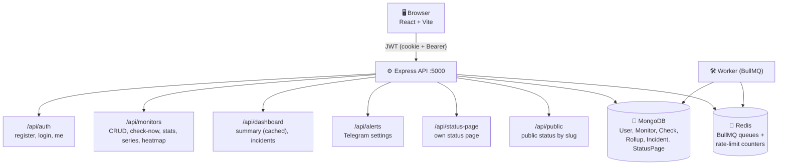

<div align="center">

# 📡 Radar

### Uptime & performance monitoring for web apps and APIs

Tracks response times, detects cold starts on free-tier hosts, opens incidents on downtime, and sends Telegram alerts.


[Features](#-features) · [Performance](#-performance) · [Quick Start](#-quick-start) · [Architecture](#-architecture) · [Design Decisions](#-design-decisions)

</div>

---

## ✨ Features

| | Feature | Description |
|---|---|---|
| 🟢 | **Uptime monitoring** | HTTP/HTTPS checks with per-phase timing: DNS, TCP, TLS, TTFB, download |
| 🥶 | **Cold start detection** | Learns each site's normal TTFB and flags slow wake-ups after idle |
| 😴 | **Sleep schedule** | Keeps your app awake only during hours people use it, saving hours on hosts that bill by running time |
| 🚨 | **Incident tracking** | Opens an incident after 3 failed checks, resolves on recovery, sends a Telegram alert |
| 📈 | **Long-range history** | 90-day charts built from hourly rollups, not raw checks |
| 🌐 | **Public status page** | Shareable URL, no login needed |
| 🛡️ | **Safety-gated cleanup** | Raw checks are deleted only after their rollup is built |

---

## ⚡ Performance

Measured under k6 load (5 VUs, 60s, median of 3 runs):

| Metric | Baseline | After | Change |
|:---|---:|---:|:---:|
| **p50** | 639 ms | 192 ms | 🟢 **-70%** |
| **p95** | 920 ms | 481 ms | 🟢 **-48%** |
| **RPS** | 2.68 | 3.60 | 🟢 **+34%** |

**How it was achieved**

- 🗂️ Compound index `{ monitorId, checkedAt }` on the `checks` collection
- ♻️ 20-second stale-while-revalidate cache on the dashboard
- 🔁 Single-flight request coalescing to prevent cache stampede

> 📖 Full journey and methodology: [`load-tests/BENCHMARKS.md`](load-tests/BENCHMARKS.md)

---

## 🧰 Tech Stack

| Layer | Technologies |
|:---|:---|
| **Backend** | Node.js, Express 5, Mongoose 9, BullMQ 6, ioredis 6 |
| **Frontend** | React 18, Vite 5, Recharts |
| **Data** | MongoDB, Redis |
| **Auth** | JWT (httpOnly cookie + Bearer), bcrypt |
| **Alerts** | Telegram Bot API |
| **Load testing** | k6 |

---

## 🚀 Quick Start

### Requirements

- **Node.js** 20+
- **MongoDB** (local or Atlas free tier)
- **Redis** (local or Upstash free tier)

### 1. Backend

```bash
cd backend
npm install
cp .env.example .env        # then edit MONGO_URL, REDIS_URL, JWT_SECRET
npm run dev                 # http://localhost:5000
```

Optional, in a second terminal, start the worker:

```bash
cd backend
npm run worker
```

### 2. Frontend

```bash
cd frontend
npm install
cp .env.example .env        # set VITE_API_URL=http://localhost:5000/api
npm run dev                 # http://localhost:5173
```

### 3. Try it

Register a user in the browser, add a monitor, and checks start flowing. 🎉

---

## 🔐 Environment Variables

**Minimum required** in `backend/.env`:

```env
MONGO_URL=mongodb+srv://...
REDIS_URL=redis://localhost:6379
JWT_SECRET=<32+ random characters>
```

**Optional:**

```env
TELEGRAM_BOT_TOKEN=    # for alerts
CLIENT_URL=            # CORS allowlist (comma-separated)
RATE_LIMIT_DISABLED=false
AUTO_CLEANUP=false
```

**Frontend** `frontend/.env`:

```env
VITE_API_URL=http://localhost:5000/api
```

> Full list in `backend/.env.example` and `frontend/.env.example`.

---

## 📜 Scripts

<details open>
<summary><b>Backend</b></summary>

| Command | What it does |
|:---|:---|
| `npm run dev` | API with nodemon |
| `npm run worker` | BullMQ worker |
| `npm start` | API + worker in one process (production) |
| `npm run seed` | Insert test data |
| `npm run seed:clean` | Remove test data |
| `npm run rollup` | Manually run hourly rollups |
| `npm run cleanup` | Dry-run cleanup (add `--apply` to delete) |
| `npm run backup` | Full backup to `backups/<timestamp>/` |
| `npm run restore` | Restore from backup |
| `npm run db:stats` | Database stats |

</details>

<details open>
<summary><b>Frontend</b></summary>

| Command | What it does |
|:---|:---|
| `npm run dev` | Vite dev server |
| `npm run build` | Production build |
| `npm run preview` | Preview production build |

</details>

---

## 🌱 Seed Data

For local development and load testing, `npm run seed` inserts **3 fake monitors** (`SEED Portfolio`, `SEED Free-tier API`, `SEED Blog`) with **~12,000 historical checks** across 14 days. URLs use `example.com`, so no real HTTP requests are sent.

```bash
cd backend
npm run seed -- --days=14 --interval=5    # 14 days, every 5 minutes
npm run seed:clean                        # remove all SEED data
```

> ⚠️ Seeded monitors are created **paused**: the worker will not touch them and no alerts fire. Use a test account, not your main account.

---

## 🔥 Load Testing

1. Install k6: https://k6.io/docs/get-started/installation/
2. Seed test data and run the backend with `RATE_LIMIT_DISABLED=true`
3. Run a test:

```powershell
cd load-tests
$env:BASE_URL="http://localhost:5000"
$env:EMAIL="test@example.com"
$env:PASSWORD="test-password"
$env:VUS="5"
$env:DURATION="60s"

k6 run --out json=results/dashboard-run.json k6/dashboard.js
```

Scripts and methodology live in [`load-tests/`](load-tests/).

---

## 🏗️ Architecture



**Worker pipeline**

```text
per-check:  schedule gate → HTTP → cold-start → save → incident → alert
per-hour:   rollup aggregation → optional cleanup
```

> In production (`npm start`), API and worker run in **one process**. In development, run them separately (`npm run dev` + `npm run worker`).

---

## 🧠 Design Decisions

<details>
<summary><b>📊 Rollups store sums and counts, not averages</b></summary>

<br>

Averaging pre-computed averages is wrong when buckets have different sizes. Cards store `rtSum` and `total`; averages are computed at query time.

</details>

<details>
<summary><b>🧹 Cleanup never deletes a check whose rollup is missing</b></summary>

<br>

Dry-run and apply share the same per-hour traversal. A gate blocks deletion unless `raw_count <= rollup_total`.

</details>

<details>
<summary><b>⏰ Sleep schedule reads from the database, not the scheduler</b></summary>

<br>

BullMQ schedulers stay on a fixed interval; the worker re-checks per job. A schedule change takes effect immediately.

</details>

<details>
<summary><b>🛡️ SSRF defense is two-phase</b></summary>

<br>

URL validation at submission **plus** a custom lookup at connect time, so DNS rebinding between the two checks is blocked.

</details>

<details>
<summary><b>⚡ Cache is in-memory with stale-while-revalidate</b></summary>

<br>

20s TTL, single-flight. Users always get a response instantly; refresh happens in the background. Up to 40s of stale dashboard data is possible, which is invisible given the frontend's 15s poll.

</details>

---

## ⚠️ Known Limitations

- MongoDB Atlas M0 shows **±30% run-to-run variance**. Benchmarks use 3-run medians.
- Cache effectiveness depends on traffic shape: 5 shared VUs hit ~99%, single-user polling hits ~25%.
- No automated tests yet *(planned)*.
- No CI pipeline yet *(planned)*.

---

## 📄 License

Released under the [ISC License](https://opensource.org/licenses/ISC).

<div align="center">

⭐ If you find Radar useful, consider giving it a star!

</div>